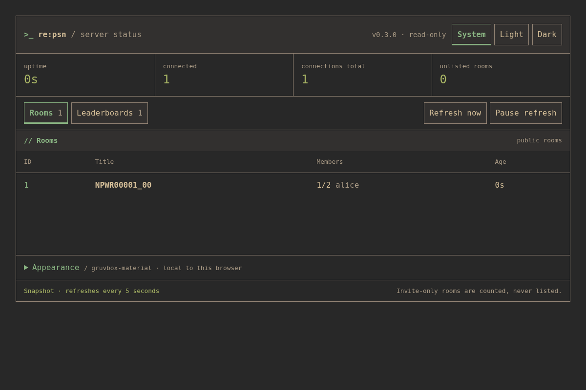

# re-psn

A reimplementation of PSN's matchmaking rooms and leaderboards, for PS3 titles
statically recompiled with [ps3recomp](https://github.com/sp00nznet/ps3recomp).
It is the PS3 counterpart of [xlive](https://github.com/sp00nznet/xlive). The
server hands out rooms and each peer's address; the players' game traffic then
goes directly between them.

## Credits and naming

re-psn is a fork of [psnr](https://github.com/sp00nznet/psnr) by sp00nz (sp00nznet on GitHub), who wrote the original server, the C client and the
protocol. The MIT licence and copyright line are kept in [LICENSE](LICENSE), and the upstream work stays credited in [NOTICE.md](NOTICE.md). This
fork adds hardened CI, community files, logging, invite-only rooms, reverse proxy support, settings from environment variables, release archives and
a Docker folder; its changes are in [CHANGELOG.md](CHANGELOG.md).

The project is called re-psn, and so is the server program (`re-psn`, `re-psn.exe` on Windows). The C client files keep the name psnr
(`client/psnr.c`), as do the Go module path and the protocol, so the code stays easy to compare with upstream. Settings are `RE_PSN_*` variables.

**Coming from `PSNR_*` settings:** nothing breaks. The old `PSNR_<FLAG>` names are still read, and the server logs a warning
at start naming each old variable and its `RE_PSN_<FLAG>` replacement (never the value). Rename them when convenient; if
both names are set with different values, the `RE_PSN_` one wins. See [docs/running.md](docs/running.md), "Environment
variables".

**Coming from the `psnr` binary:** the server is now built as `re-psn` (`re-psn.exe`), and no `psnr` copy is shipped; `Setup.cmd` and
`setup.sh` leave a `Start re-psn.cmd` / `start-re-psn.sh` launcher (an old launcher still starts the old build). Release archives are
named `re-psn-vX.Y.Z-<os>-<arch>`. The systemd unit is `re-psn.service`: it starts `/usr/local/bin/re-psn` and reads the old
`/etc/psnr/psnr.env`, then `/etc/re-psn/re-psn.env` (both optional; the new one wins), and keeps `/var/lib/psnr`; run
`systemctl disable --now psnr` before enabling it. The image and the compose service are `re-psn` (start compose with
`--remove-orphans` once to drop the old `psnr` container). Old settings keep working.

## Status

**v0.1.0, alpha.**
- **Server:** rooms (Matching2-style) and leaderboards (Score-style) work, and
  the C client works. Both are tested against each other on Windows and Linux.
- **Games:** Simpsons Arcade plays an online match as two instances on one
  machine: create match, Quick Match, lobby, characters, then Stage 1
  together, in sync. Game traffic goes peer to peer. The work is
  [ps3recomp#200](https://github.com/sp00nznet/ps3recomp/pull/200) (draft)
  and the lifter fix
  [ps3recomp#202](https://github.com/sp00nznet/ps3recomp/pull/202), on top
  of the merged
  [ps3recomp#196](https://github.com/sp00nznet/ps3recomp/pull/196).
  [ROADMAP.md](ROADMAP.md) has the rest.

## Screenshots

The status page (`http://127.0.0.1:36101/`) with one room open and two
leaderboards:



## Getting Started

### Quick start

1. Download this repository as a zip and unpack it.
2. Double-click **`Setup.cmd`** (Windows) or run **`./setup.sh`** (Linux/macOS).
   - The script checks for Go and asks before installing it (winget, about
     70 MB).
   - It then builds the server and leaves a **`Start re-psn.cmd`** (or
     `start-re-psn.sh`) launcher in the folder.
3. Run the launcher, then open http://127.0.0.1:36101/ in a browser.

If setup fails, it prints one line saying what to do and where the full log is.

### Step by step

Prerequisites: Go 1.22 or newer (`go version`). On Windows, a new terminal
window is needed after installing Go before `go` is on `PATH`.

1. Build:
   ```
   cd server
   go build -o re-psn.exe .   # "re-psn" on Linux/macOS
   ```
2. Run:
   ```
   re-psn.exe
   ```
   Expected output:
   ```
   time=2026-09-29T02:17:35.000+00:00 level=INFO msg=started version=0.1.0 clients=[::]:36100 udp=[::]:36100 relay=false
   time=2026-09-29T02:17:35.000+00:00 level=INFO msg="status page" addr=127.0.0.1:36101 token=false
   ```
3. Open http://127.0.0.1:36101/. It shows no rooms and no leaderboards until a
   client connects.

Players connect to TCP 36100. Ports, flags and Docker are covered in
[docs/running.md](docs/running.md).

## Usage

```
re-psn -addr :36100 -http 127.0.0.1:36101 -v  # log every room event
docker compose -f docker/docker-compose.yml up -d   # same thing, in a container (docker/README.md)
curl http://127.0.0.1:36101/api/stats         # rooms and boards as JSON
```

To talk to it from C, add `client/psnr.c` and `client/psnr.h` to the build:

```c
psnr_client* c = psnr_connect("server", 36100, "NPWR00860_00", "alice",
                              3658 /* P2P port */, &user_id, public_ip);
uint32_t req = psnr_send(c, PSNR_SEARCH_ROOMS, body, len);   /* async */
psnr_msg m;
while (psnr_poll(c, &m) == 1) {        /* replies and pushes, never blocks */
    /* m.req == req for its reply; m.req == 0 for MEMBER_JOINED etc. */
    psnr_msg_free(&m);
}
```

Every message is documented in [docs/api.md](docs/api.md).

### Playing online

A recompiled title goes online when these are set in its environment (this
needs a ps3recomp build with
[#200](https://github.com/sp00nznet/ps3recomp/pull/200); its `docs/ONLINE.md`
has the full list):

```
PS3_NET_ONLINE=1           # real sockets instead of the offline stubs
PSNR_SERVER=host[:port]    # this server
PS3_NP_ONLINE_ID=homer     # the player's name; also gives the instance its own console identity
PS3_NET_P2P_PORT=3658      # the UDP/TCP port peers reach this player on
PS3_VERBOSE=0              # keep diagnostic logging from slowing the game down
```

Two instances on one machine need different `PS3_NP_ONLINE_ID`s and
`PS3_NET_P2P_PORT`s. Across machines, each player's P2P port must be reachable
by the others.

## Docs

- [docs/architecture.md](docs/architecture.md): the parts, why the client has
  no threads, and why game traffic doesn't go through the server
- [docs/api.md](docs/api.md): the protocol
- [docs/running.md](docs/running.md): flags, ports, Docker, state
- [docs/connecting.md](docs/connecting.md): ways players connect: LAN, port forwarding, a public server, Tailscale or ZeroTier
- [docker/](docker/README.md): building and running the server in a container
- [deploy/](deploy/README.md): the settings file, systemd unit and reverse proxy examples
- [lab/](lab/README.md): players behind NATing routers, in Docker (`lab/run.sh`)

## Building from source

```
go vet ./...
go test ./...      # also builds and runs client/test_psnr.c if a C compiler is on PATH
```

To test the C client on its own against a running server:

```
cc -std=gnu11 -o test_psnr client/psnr.c client/test_psnr.c    # add -lws2_32 on Windows
./test_psnr 127.0.0.1 36100
```

## Security

There are no accounts or passwords, and everyone in a room learns the other
players' IP addresses. Run it for people you'd let onto your network. Details
are in [SECURITY.md](SECURITY.md).

## License

MIT. See [LICENSE](LICENSE).

re-psn is an independent project. It is not affiliated with or endorsed by Sony
Interactive Entertainment; PlayStation and PSN are its trademarks. It contains
no Sony code or game content, and implements its own protocol. You need your
own legally obtained copies of the games.
