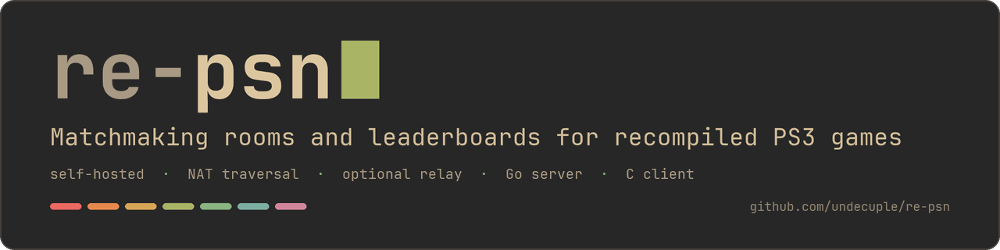
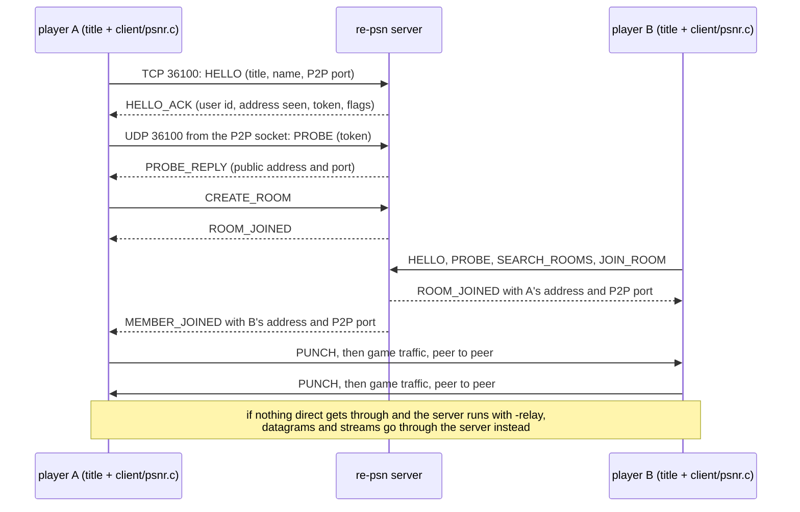

# re-psn



A reimplementation of PSN's matchmaking rooms and leaderboards for statically recompiled PS3 games, with NAT traversal and an
optional relay.

[](https://github.com/undecuple/re-psn/actions/workflows/ci.yml)
&nbsp;**Status:** pre-release <!-- version -->v0.1.0<!-- /version -->, unreleased (no tag yet) · Go server, C client · MIT

[Quick start](#install) · [Features](#features) · [Configuration](#configuration) · [Docs](#documentation) ·
[Roadmap](ROADMAP.md) · [Security](SECURITY.md)

## Contents

- [About this fork](#about-this-fork)
- [Overview](#overview)
  - [A session, step by step](#a-session-step-by-step)
  - [Using it from a game](#using-it-from-a-game)
- [Example](#example)
- [Features](#features)
- [Install](#install)
  - [Release archives](#release-archives)
  - [Container](#container)
  - [From source](#from-source)
- [Configuration](#configuration)
  - [Settings](#settings)
  - [Coming from PSNR_ settings or the psnr binary](#coming-from-psnr_-settings-or-the-psnr-binary)
  - [Ports](#ports)
  - [Reverse proxy, status page, limits and storage](#reverse-proxy-status-page-limits-and-storage)
- [Security and privacy](#security-and-privacy)
- [Documentation](#documentation)
- [Roadmap and contributing](#roadmap-and-contributing)
- [Credits](#credits)
- [Licence](#licence)
- [How AI was used](#how-ai-was-used)

## About this fork

re-psn is a fork of [psnr](https://github.com/sp00nznet/psnr) by sp00nz, who wrote the original server, the C client and the
protocol. Upstream's MIT licence and copyright line are kept in [LICENSE](LICENSE), and [NOTICE.md](NOTICE.md) credits the
upstream work. On top of it this fork adds (details in [CHANGELOG.md](CHANGELOG.md)):

- **Hardened CI** (race detector, vulnerability, secret and code scans, the NAT lab) and fuzz tests.
- **Invite-only rooms** with an 8-character code, **limits** on rooms, connections and request rate, and **logging** with levels.
- **Reverse proxy support**, a **status page token**, `RE_PSN_*` **settings** and a **UDP source check** on address probes.
- **Release archives** with checksums (none published yet), **Docker and Podman** files, deployment examples and a
  [features list](docs/features.md).

> [!NOTE]
> re-psn is not affiliated with or endorsed by Sony Interactive Entertainment. It is not for piracy: this repository contains no game
> files, keys or firmware, and you need none from it. Play only games you own.

## Overview

A recompiled PS3 game that wants to play online needs someone to answer its matchmaking and leaderboard calls. re-psn is that
someone, for a group running its own server: a LAN, a VPN, or friends connecting to one person's machine. The server keeps rooms
and leaderboards and tells each player where the others are; the game traffic itself goes directly between players, and through
the server only when two players cannot reach each other and the host has turned the relay on.

### A session, step by step

1. **The host starts re-psn**, listening on TCP and UDP 36100, with a status page on `127.0.0.1:36101`.
2. **A game connects** through the C client (`client/psnr.c`): HELLO with the game's ID, the player's name and P2P port; HELLO_ACK
   returns a user id, the address the server sees, a token and flags (relay on, invite-only rooms).
3. **A UDP PROBE** from the game's P2P socket tells the server its public address and port (accepted only from the TCP address).
4. **Rooms:** one player creates a room, others search and join, or join with a code. Each member entry carries the address and
   P2P port that work from where the receiving player is.
5. **Direct:** both sides send PUNCH packets to open their routers, then play peer to peer.
6. **Relay, if needed:** when nothing direct gets through and the server runs with `-relay`, traffic goes through the server.
   Without it, players need port forwarding or a shared VPN.

Leaderboards use the same TCP connection: each player's best score per board, ranked by range or by name.



More in [docs/architecture.md](docs/architecture.md) (the parts, the relay) and [docs/api.md](docs/api.md) (every message).

### Using it from a game

Games are recompiled with [ps3recomp](https://github.com/sp00nznet/ps3recomp), whose NP modules talk to re-psn through the C client.
That side is upstream's work and not part of this repository: it needs a ps3recomp build with
[ps3recomp#200](https://github.com/sp00nznet/ps3recomp/pull/200) (a draft), where `PS3_NET_ONLINE=1` and `PSNR_SERVER=host[:port]`
point a game at the server (its `docs/ONLINE.md` lists the rest). With it, upstream has played Simpsons Arcade online, two players
from lobby to Stage 1 in sync, on one machine and later across two with either player behind a NAT.

## Example

Two test players meet in a room and connect directly. They are `lab/natcheck.c`, the NAT lab's player, which does what the
runtime does for a game (HELLO, probe, room, punch, ping, a stream) without one. Built from a fresh clone with the commands shown.

Captured from a local run on loopback: start the server with the defaults.

```text
$ ./re-psn
time=2026-11-05T22:37:02.339Z level=INFO msg=storage backend=memory
time=2026-11-05T22:37:02.340Z level=INFO msg=started version=0.1.0 clients=[::]:36100 udp=[::]:36100 relay=false
time=2026-11-05T22:37:02.340Z level=INFO msg="status page" addr=127.0.0.1:36101 token=false
```

The rest comes from a second run of the same build, started as `./re-psn -v` (debug log).

Captured from a local run on loopback: build the test player, and let alice host a room in one terminal.

```text
$ gcc -std=gnu11 -o natcheck client/psnr.c lab/natcheck.c
$ ./natcheck 127.0.0.1 alice host 3658
alice: P2P socket seen at 127.0.0.1:3658
alice: the other player is at 127.0.0.1:3659
PASS alice: "PONG bob" direct
PASS alice: stream direct, got "ACK from bob"
```

Captured from a local run on loopback: in a second terminal, while alice waits, the status page shows her room; then bob joins.

```text
$ curl -s http://127.0.0.1:36101/api/stats
{"uptime":"2s","clients":1,"connections_total":1,"rooms":[{"id":1,"title":"NPWR00001_00","members":["alice"],"max":2,"age":"1s"}],"unlisted_rooms":0,"boards":[]}
$ ./natcheck 127.0.0.1 bob join 3659
bob: P2P socket seen at 127.0.0.1:3659
bob: the other player is at 127.0.0.1:3658
PASS bob: "PONG alice" direct
PASS bob: stream direct, got "SETUP from alice"
```

Captured from a local run on loopback: the C client's own test (`client/test_psnr.c`: HELLO, a room joined by a second client,
a room message, a score), then the leaderboard it left on the status page.

```text
$ gcc -std=gnu11 -o test_psnr client/psnr.c client/test_psnr.c
$ ./test_psnr 127.0.0.1 36100
test_psnr: all passed
$ curl -s http://127.0.0.1:36101/api/stats
{"uptime":"6s","clients":0,"connections_total":4,"rooms":[],"unlisted_rooms":0,"boards":[{"title":"NPWR00001_00","board":1,"entries":1,"leader":"alice","best":100}]}
```

http://127.0.0.1:36101/ shows the same as a page. Routers and the relay are tested in Docker by the [NAT lab](lab/README.md).

## Features

Available on `main` today; [docs/features.md](docs/features.md) has the evidence and notes for each row.

| ID | Feature | In one line |
|---|---|---|
| `rooms-basic` | Rooms and search | Create, search, join and leave rooms, room messages, owner handoff. |
| `rooms-data` | Room and member data | External and internal room data, room flags searchers see, member data. |
| `rooms-codes` | Invite-only rooms | An 8-character code; the room leaves search and the status page. |
| `scores-boards` | Leaderboards | Best score per player, higher- or lower-is-better, ranks by range or name. |
| `players-names` | One player per name | A name in use from another address is refused; the same address takes over. |
| `store-interface` | Storage interface | Scores go through a storage layer; only `off` and `memory` exist, so nothing is kept across a restart yet. |
| `limits-requests` | Request and connection limits | Rooms, rooms per player, connections per address, request rate, data size. |
| `logs-levels` | Log levels and formats | debug to error, text or JSON, an optional log file; tokens never logged. |
| `status-page` | Status page and /api/stats | Read-only, on localhost by default, with an optional token. |
| `proxy-support` | PROXY protocol and trusted proxies | The real client address counts behind a reverse proxy. |
| `deploy-examples` | Settings file, service unit, Traefik example | In `deploy/`, shipped as `examples/` in the archives. |
| `deploy-container` | Docker and Podman | A Dockerfile and compose file configured by `RE_PSN_*` variables. |
| `settings-env` | Flags and RE_PSN_* variables | Every flag as a variable; the old `PSNR_*` names still work. |
| `net-punch` | Address discovery and hole punching | UDP probes; each player gets the address that works from where they are. |
| `net-relay` | Relay | Optional: streams and datagrams through the server when direct fails. |
| `net-udp-guard` | UDP source address check | Probes and relayed packets only from the player's TCP address. |
| `client-c` | C client | One file, no dependencies, no threads. |
| `test-fuzz` | Fuzz tests | Frame parser, request handlers, PROXY header. |
| `ci-checks` | CI checks | Race detector, vulnerability and secret scans, NAT lab, code scanning. |
| `docs-features` | Features list | Generated from `docs/features.tsv` and checked in CI. |
| `docs-diagrams` | Mermaid diagrams | Architecture, reverse proxy, relay and NAT lab. |
| `docs-markdown` | Docs in Markdown | One layout for every doc. |
| `docs-connecting` | Ways to connect | LAN, port forwarding, a public server, Tailscale or ZeroTier; [docs/connecting.md](docs/connecting.md). |
| `docs-readme` | README rewrite | This page. |

Rows that are partial, not yet verified, planned or later (release archives, the nginx and HAProxy examples, storage backends, the
desktop apps and more) are in [docs/features.md](docs/features.md) and [ROADMAP.md](ROADMAP.md).

## Install

### Release archives

> [!WARNING]
> No release has been published yet. The workflow is in place; until the first tag, build from source or use the container.

Each release will carry `re-psn-vX.Y.Z-windows-amd64.zip`, `re-psn-vX.Y.Z-linux-amd64.tar.gz` and
`re-psn-vX.Y.Z-linux-arm64.tar.gz` (built by [scripts/release-build.sh](scripts/release-build.sh)): a static `re-psn` binary
(`re-psn.exe` on Windows), `LICENSE`, `NOTICE.md` and the deployment examples in `examples/`. Each archive has a `.sha256` file, and
`SHA256SUMS` lists them all. Check a download with `sha256sum -c SHA256SUMS --ignore-missing` on Linux, or compare the output of
`Get-FileHash <archive>` with the line in `SHA256SUMS` on Windows.

### Container

No image is published; build it from this repository with Docker or Podman:

```sh
docker build -f docker/Dockerfile -t re-psn .            # or: podman build -f docker/Dockerfile -t re-psn .
docker run --rm -p 36100:36100 -p 36100:36100/udp re-psn
docker compose -f docker/docker-compose.yml up -d        # the same, with a restart policy
```

It is configured only by `RE_PSN_*` variables; [docker/README.md](docker/README.md) covers ports, the status page and Podman.

### From source

Prerequisites: Go 1.22 or newer (as in `go.mod`); a C compiler only for the C client and its tests. The quick way is `Setup.cmd`
(Windows; it offers to install Go with winget) or `./setup.sh` (Linux, macOS): both build the server in `server/` and leave a
`Start re-psn.cmd` or `start-re-psn.sh` launcher. By hand from the repository root, captured from a local run on loopback (the
build prints nothing when it succeeds):

```text
$ go version
go version go1.26.10 linux/amd64
$ go build -o re-psn ./server
```

Run the tests with `go vet ./...` and `go test ./...` (on Linux with a C compiler, this also builds and runs the C client test).

## Configuration

### Settings

Every flag can also be set as a `RE_PSN_<FLAG>` variable (upper case, dashes as underscores). A flag on the command line wins,
then the variable. A value that does not parse stops the server at start. Defaults are those of `./re-psn -h`.

| Flag | Variable | Default | What it does |
|---|---|---|---|
| `-addr` | `RE_PSN_ADDR` | `:36100` | TCP and UDP address for game clients |
| `-tcp-addr` | `RE_PSN_TCP_ADDR` | `-addr` | TCP address for game clients, if different |
| `-udp-addr` | `RE_PSN_UDP_ADDR` | `-addr` | UDP address for game clients, if different |
| `-http` | `RE_PSN_HTTP` | `127.0.0.1:36101` | Status page and `/api/stats`; empty turns it off |
| `-http-token` | `RE_PSN_HTTP_TOKEN` | none | Token the status page requires (`Authorization: Bearer`, or `?token=`) |
| `-max-rooms` | `RE_PSN_MAX_ROOMS` | `1000` | Rooms across all titles |
| `-max-player-rooms` | `RE_PSN_MAX_PLAYER_ROOMS` | `8` | Rooms one player may be in at once (0: no limit) |
| `-max-conns-per-addr` | `RE_PSN_MAX_CONNS_PER_ADDR` | `32` | Open connections per remote address (0: no limit) |
| `-max-req-rate` | `RE_PSN_MAX_REQ_RATE` | `200` | Requests per second per connection before it is closed (0: no limit) |
| `-v` | `RE_PSN_V` | off | Same as `-log-level debug` |
| `-log-level` | `RE_PSN_LOG_LEVEL` | `info` | `debug` (room events), `info`, `warn` or `error` |
| `-log-format` | `RE_PSN_LOG_FORMAT` | `text` | `text` or `json` |
| `-log-file` | `RE_PSN_LOG_FILE` | none | Also append the log to this file (mode 0600) |
| `-trusted-proxies` | `RE_PSN_TRUSTED_PROXIES` | none | Reverse proxies allowed to name the real client (CIDRs or addresses) |
| `-proxy-protocol` | `RE_PSN_PROXY_PROTOCOL` | off | Require a PROXY v1/v2 header from a trusted proxy on the game TCP port |
| `-udp-any-source` | `RE_PSN_UDP_ANY_SOURCE` | off | Accept UDP probes and relay packets from another address than the player's TCP one |
| `-relay` | `RE_PSN_RELAY` | off | Carry traffic for players who cannot reach each other (uses the host's bandwidth) |
| `-db` | `RE_PSN_DB` | `off` | Score storage: `off` or `memory` |
| `-db-file` | `RE_PSN_DB_FILE` | none | Read the `-db` setting from this file instead |

[deploy/re-psn.env.example](deploy/re-psn.env.example) lists every variable with a comment, and [docs/running.md](docs/running.md)
has the full text.

### Coming from PSNR_ settings or the psnr binary

Nothing breaks. The old `PSNR_<FLAG>` names are still read after `RE_PSN_<FLAG>`; when one is used, the server logs a warning at
start naming the old and the new variable, never the value. If both are set and differ, `RE_PSN_<FLAG>` wins, with a warning.
Captured from a local run on loopback:

```text
$ PSNR_MAX_ROOMS=50 ./re-psn
time=2026-11-05T22:37:03.659Z level=WARN msg="old variable name; it still works, rename it when convenient" old=PSNR_MAX_ROOMS new=RE_PSN_MAX_ROOMS
```

The binary is now `re-psn` (`re-psn.exe`); no `psnr` copy is built. The unit `re-psn.service` reads `/etc/psnr/psnr.env`, then
`/etc/re-psn/re-psn.env` (run `systemctl disable --now psnr` first); the image and compose service are `re-psn` (use
`--remove-orphans` once). The Go module path, the C client's `psnr_*` API and the wire format keep upstream's names.

### Ports

| Port | Protocol | Open to |
|---|---|---|
| 36100 | TCP and UDP | Every player: game connection and address probes |
| 36101 | TCP | You only: the status page lists every online ID |
| each player's P2P port (3658 unless the game's `PS3_NET_P2P_PORT` says otherwise) | UDP and TCP | The other players; the game opens it |

Players on one LAN or VPN need nothing forwarded. Firewall commands are in [docs/running.md](docs/running.md#firewall).

### Reverse proxy, status page, limits and storage

- **Reverse proxy:** off by default. With `-trusted-proxies` and `-proxy-protocol`, the real player address counts for the limits,
  the name rule and the address other players receive. UDP is never proxied: publish it straight to the host. See
  [docs/running.md](docs/running.md#behind-a-reverse-proxy) and [deploy/README.md](deploy/README.md) (Traefik tested; nginx and
  HAProxy not yet run).
- **Status page token:** set `-http-token` whenever `-http` is not on localhost; the server warns at start if it is reachable
  without one.
- **Limits:** room data is capped at 4096 bytes; the four `-max-*` settings above cover the rest. Each refusal is logged at warn level.
- **Storage:** `-db` accepts only `off` (the default) and `memory`, which both keep scores in memory; a restart empties every
  board. Database backends are planned ([docs/features.md](docs/features.md#storage)); a database setting stops the server at start.

## Security and privacy

- **What the server stores:** nothing on disk. Rooms, names and scores live in memory; the only file is the log, if you set
  `-log-file` (it holds online IDs and addresses, never tokens).
- **What other players learn:** everyone in a room receives the other members' IP addresses and P2P ports, because that is how they
  connect. The status page lists every connected online ID, which is why it stays on localhost or behind a token.
- **No accounts:** a name is not authenticated; anyone who can reach TCP 36100 can join. Run it for people you would let onto your
  network.

Limits, the UDP source check and how to report a vulnerability privately are in [SECURITY.md](SECURITY.md).

## Documentation

| Document | What is in it |
|---|---|
| [docs/architecture.md](docs/architecture.md) | The parts, the threadless client, why game traffic is peer to peer, the relay |
| [docs/api.md](docs/api.md) | The protocol: framing, session, rooms, leaderboards, UDP, relay, HTTP |
| [docs/running.md](docs/running.md) | Flags, variables, UDP source check, reverse proxy, logging, ports, firewall, storage |
| [docs/features.md](docs/features.md) | Every feature with its status and evidence (generated from [docs/features.tsv](docs/features.tsv)) |
| [docs/connecting.md](docs/connecting.md) | Ways players connect: LAN, port forwarding, a public server, Tailscale or ZeroTier |
| [docs/releasing.md](docs/releasing.md) | The version, the bump and cutting a pre-release (for maintainers) |
| [deploy/README.md](deploy/README.md) | Settings file, systemd unit, Traefik, nginx and HAProxy examples |
| [docker/README.md](docker/README.md) | Building and running the container with Docker or Podman |
| [lab/README.md](lab/README.md) | The NAT lab: players behind routers in Docker |
| [CHANGELOG.md](CHANGELOG.md), [NOTICE.md](NOTICE.md) | What changed; third-party components and credits |

## Roadmap and contributing

[ROADMAP.md](ROADMAP.md) lists what is done, what is planned (storage, health checks, desktop apps, private rooms and more) and what
is out of scope: re-psn is for groups running their own server, not a public PSN replacement. Bug reports, fixes and ideas are
welcome through the issue forms or a pull request; [CONTRIBUTING.md](CONTRIBUTING.md) has the ground rules and the tests to run.

## Credits

- **sp00nz** ([sp00nznet](https://github.com/sp00nznet)) wrote [psnr](https://github.com/sp00nznet/psnr): the server, the C client,
  the protocol, NAT traversal, the relay and the NAT lab. Thanks to everyone in
  [upstream's contributors](https://github.com/sp00nznet/psnr/graphs/contributors).
- [ps3recomp](https://github.com/sp00nznet/ps3recomp) is the recompiler whose NP modules use the client, and re-psn follows the
  model of [xlive](https://github.com/sp00nznet/xlive): the server handles discovery, game traffic goes peer to peer.

## Licence

MIT, see [LICENSE](LICENSE); upstream's copyright line is kept. PlayStation, PS3 and PSN are trademarks of Sony Interactive
Entertainment, used only to say what the server stands in for.

## How AI was used

Developed with AI agent assistance. Every change is reviewed and tested before it is merged: CI runs gofmt, go vet, the Go tests with
the race detector on Linux (including the C client against the server) and on Windows, the features list check, a vulnerability
scan, a secret scan over the full history and the NAT lab, and code scanning runs on its own workflow.
