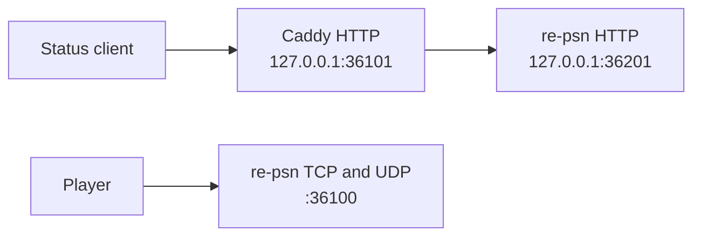

# Caddy status-page example

This example uses stock Caddy 2 to proxy the HTTP status page on the same host. It is written from Caddy's
documentation and has **not been run or checked with `caddy validate`**. The default listener is loopback HTTP so
copying the file does not expose the status page or request a certificate. The explicit `bind 127.0.0.1` restricts
the socket; the hostname in the site address alone would not do that (see [bind](https://caddyserver.com/docs/caddyfile/directives/bind)).
Caddy is optional; it is not bundled.

## Addresses and settings

| Traffic | Listener | Destination |
|---|---|---|
| Status page | Caddy, `127.0.0.1:36101` | re-psn, `127.0.0.1:36201` |
| Game TCP and UDP | re-psn, `:36100` | Direct from players |

Set `RE_PSN_HTTP` to `127.0.0.1:36201` and `RE_PSN_TRUSTED_PROXIES` to `127.0.0.1/32` in your private settings file.
Leave `RE_PSN_PROXY_PROTOCOL` off: Caddy is proxying HTTP only, and the game TCP port still accepts players directly.
Enable `RE_PSN_HTTP_TOKEN` before exposing the status page beyond localhost. The server checks the client's bearer
header or token query as usual; the config does not insert a token or grant access to an unauthenticated request.



The [Caddyfile](Caddyfile) removes `CF-Connecting-IP` before forwarding. re-psn gives that header precedence over
`X-Forwarded-For` from a trusted proxy, so a direct visitor must not be allowed to choose it. Caddy's default
[forwarded-header handling](https://caddyserver.com/docs/caddyfile/directives/reverse_proxy#defaults) sets
`X-Forwarded-For` from the connection and ignores an untrusted visitor's supplied chain. This example assumes Caddy
is the first proxy. An additional CDN or proxy needs its own reviewed trust configuration; do not trust every address.

## Validate and run on your host

From the repository root, with Caddy 2 already installed:

```sh
caddy validate --config deploy/caddy/Caddyfile --adapter caddyfile
caddy run --config deploy/caddy/Caddyfile --adapter caddyfile
```

The release build copies this directory into future archives as `examples/caddy/`; no existing release is changed.
In such an archive, use `examples/caddy/Caddyfile` instead. Validation checks the config, not the reachability of
the upstream or the effectiveness of the status-page token. Test unauthenticated rejection, an authenticated page
load and forwarded client addresses before relying on it. No Caddy binary, image or third-party module was run for
this example.

To expose HTTPS, replace the first line of the site block with a hostname you control, replace the loopback `bind`
with the intended public interface, and configure DNS and firewall access for it. Keep the backend on loopback and
set the status-page token first. Caddy can then manage certificates
and redirects as described in [Automatic HTTPS](https://caddyserver.com/docs/automatic-https). No public hostname or
certificate credentials are stored in this file.

## Game traffic

Stock Caddy's HTTP `reverse_proxy` does not proxy the game's TCP protocol or UDP packets. Keep those ports directed
at re-psn. A separate layer-4 plugin is outside this example, has not been tested, and would need its own dependency
and configuration review. Do not put an HTTP load balancer between a game client and the game port.
