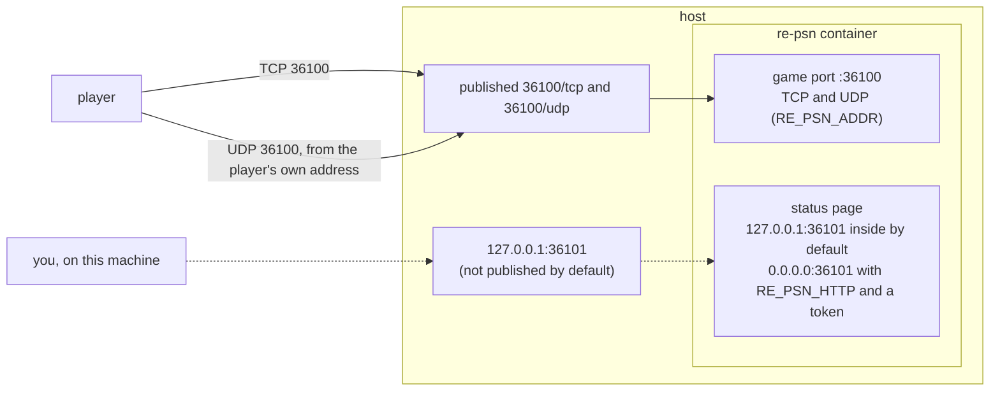
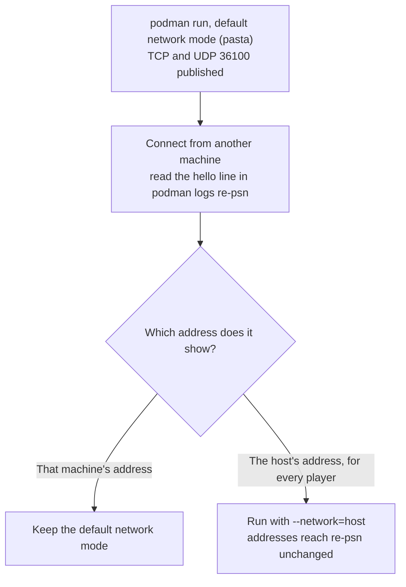

# Running re-psn in a container

How to build the re-psn image from this repository and run it with Docker or Podman, which ports to publish, and how
to set it up. No image is published yet; you build it from this repository.

## Contents

- [The files](#the-files)
- [Build and run](#build-and-run)
- [Ports](#ports)
- [Podman](#podman)
- [Settings](#settings)
- [Behind a reverse proxy](#behind-a-reverse-proxy)
- [The lab](#the-lab)

## The files

| File | What it is |
|---|---|
| `Dockerfile` | A two-stage build: Go in the first stage, a small Alpine image with one static binary in the second. |
| `docker-compose.yml` | The same, with the ports and a restart policy. |
| `Dockerfile.dockerignore` | Keeps everything but `go.mod` and `server/` out of the build context. |

## Build and run

From the repository root:

```sh
docker build -f docker/Dockerfile -t re-psn .
docker run --rm -p 36100:36100 -p 36100:36100/udp re-psn

docker compose -f docker/docker-compose.yml up -d      # the same, with the ports and a restart policy
```

The build context is the repository root, not this folder: the Dockerfile copies `go.mod` and `server/` from there. Podman works the same
way (`podman build -f docker/Dockerfile .`).

## Ports

The game port is published for TCP and UDP. The status page stays inside the container until you set it up (see
[Settings](#settings)); the compose file has the line that publishes it on this machine only, commented:



> [!WARNING]
> re-psn refuses a UDP probe whose source address differs from the player's TCP address
> ([docs/running.md](../docs/running.md#udp-source-address), "UDP source address"). UDP must reach the server with the
> player's own address, so publish it straight to the host, not through a proxy or port forwarder that rewrites the source.

## Podman

The same Dockerfile builds and runs with Podman, rootless included (ports above 1024 need no root):

```sh
podman build -f docker/Dockerfile -t re-psn .

podman run -d --name re-psn --restart=on-failure \
  -p 36100:36100/tcp -p 36100:36100/udp \
  re-psn
```

Add `-e RE_PSN_<FLAG>=value` for any setting, or `--env-file re-psn.env` (copy `deploy/re-psn.env.example` from the release archive's `examples/`, or from
this repository, and keep `re-psn.env` private; the old `PSNR_<FLAG>` names still work). Status page, from this machine only:

```sh
-e RE_PSN_HTTP=0.0.0.0:36101 -e RE_PSN_HTTP_TOKEN=<a long random string> -p 127.0.0.1:36101:36101
```

`podman logs re-psn` shows the log; `podman rm -f re-psn` stops and removes it.

> [!NOTE]
> Tested with Podman 6.1 on Linux: the image builds, a TCP connection to the published port is accepted, the status page answers 401
> without the token and 200 with it, and the restart policy is set. Not tested: compose (`podman compose` needs a compose provider),
> a systemd unit for the container (Quadlet), and Windows or macOS Podman machines.

### Check the address re-psn sees

Rootless Podman forwards published ports itself, and in the test a connection from 127.0.0.1 was logged inside the
container as the machine's own LAN address. re-psn uses the player's address for `-max-conns-per-addr`, the same-name reconnect rule and the address it
tells other players. Connect from another machine, look at the `hello` line in `podman logs re-psn`, and make sure it shows that machine's address and not
the host's; if every player shows the host's address, those features lump everyone together. Running with `--network=host` avoids the
forwarding: there the addresses reach re-psn unchanged.

Choosing the network mode, from that test:



### UDP and the source address check

re-psn refuses a UDP probe whose source address differs from the player's TCP address ([docs/running.md](../docs/running.md#udp-source-address),
"UDP source address"). Tested with rootless Podman 6.1.4 (pasta, the default network mode) and the commands above: a client sending TCP and UDP from one
address was accepted, a client sending them from two different addresses was refused, and `PSNR_UDP_ANY_SOURCE=true` accepted it; the same held with
`--network=host`. Not tested: a client on another machine, a NAT between client and host, slirp4netns, rootful Podman, and Docker.

## Settings

The image has no fixed flags. Every flag is a `RE_PSN_<FLAG>` environment variable, and the old `PSNR_<FLAG>` still works
([docs/running.md](../docs/running.md#environment-variables), "Environment variables"); the compose
file shows `RE_PSN_ADDR`. If you change a port, change the published port and your firewall too.

### The status page

The status page lists every online ID, so it is not reachable from the host by default. To reach it, bind it inside the container
and set a token, then publish the port on this machine only (the lines are in the compose file, commented):

```dotenv
RE_PSN_HTTP=0.0.0.0:36101
RE_PSN_HTTP_TOKEN=<a long random string>
```

Make the token with a random generator, not by hand. Any of these works (hex and base32 contain only characters that are safe in a `?token=` URL;
base64 can contain `+`, `/` and `=`, which then need URL-encoding):

```sh
openssl rand -hex 32                          # 64 hex characters (256 bits)
head -c 32 /dev/urandom | base32 | tr -d '='  # 52 base32 characters (256 bits), coreutils
openssl rand -base64 32                       # 44 characters, if you send it only as a Bearer header
```

All three were run (OpenSSL 3.5.9 and GNU coreutils) and gave the lengths shown.

> [!WARNING]
> A token set through the environment is visible to `docker inspect` and to other users on the host.

## Behind a reverse proxy

Set `RE_PSN_TRUSTED_PROXIES` to your proxy's address as the container sees it and `RE_PSN_PROXY_PROTOCOL=true`, and have the proxy send PROXY
protocol on the game TCP port. Publish UDP straight to the host. The release archives carry proxy examples in `examples/` (in this repository,
[deploy/](../deploy/README.md)); see [docs/running.md](../docs/running.md#behind-a-reverse-proxy), "Behind a reverse proxy".

## The lab

`lab/run.sh` builds this image and `lab/Dockerfile` (both from the repository root) and runs the NAT scenarios; see
[lab/README.md](../lab/README.md).
